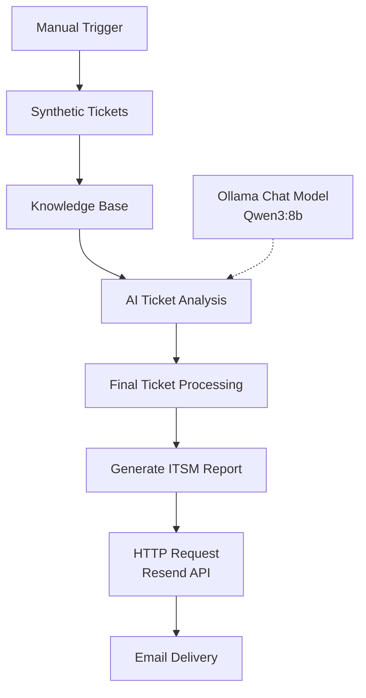

# Portfolio 02 — AI-powered IT Service Management

An AI-powered IT Service Management prototype built with n8n, Ollama, and Qwen3:8b. The project demonstrates how AI and workflow automation can support ticket classification, Knowledge Base search, SLA monitoring, and management reporting.

## 1. Project Overview

The goal of this project is to demonstrate how AI can automate part of the initial IT Service Desk ticket processing.

The system analyses incoming support tickets, identifies their categories and priorities, searches for relevant information in a Knowledge Base, checks escalation conditions, and prepares customer responses.

It also calculates SLA metrics, generates a management report, and sends the report by email.

The project is designed as a small local prototype using free tools and a locally running language model.

## 2. Main Features

- AI-powered ticket classification.
- Automatic priority assignment based on predefined rules.
- Knowledge Base search with category-specific article restrictions.
- Incident escalation condition checks.
- Automated customer response generation.
- SLA deadline and remaining-time calculation.
- Ticket statistics and management reporting.
- HTML report generation.
- Automated email delivery through Resend API.

## 3. Workflow Architecture

The system is built in n8n and consists of the following components:

### Workflow Components

**1. Manual Trigger**

Starts the workflow manually.

**2. Synthetic Tickets**

Creates five test tickets with unique IDs, subjects, descriptions, and creation timestamps.

**3. Knowledge Base**

Provides each ticket with a predefined Knowledge Base containing 10 synthetic articles.

**4. AI Ticket Analysis**

Uses Basic LLM Chain and the local Qwen3:8b model through Ollama to:

- Identify the ticket category and priority.
- Search for a relevant Knowledge Base article.
- Check mandatory escalation conditions.
- Determine the ticket status.
- Generate a classification explanation and customer response.

**5. Final Ticket Processing**

Processes the JSON returned by the AI, restores the original ticket information, validates required fields, and calculates SLA metrics.

**6. Generate ITSM Report**

Collects the results of all processed tickets, calculates summary statistics, and generates an HTML management report.

**7. HTTP Request — Resend API**

Sends the generated HTML report to the configured email address through the Resend API.

## 4. Ticket Classification and Processing Rules

Five synthetic tickets were created to demonstrate four ITSM categories.

| Ticket ID | Category | Example |
|---|---|---|
| INC-001 | Incident | Payment Gateway Unavailable |
| INC-002 | Incident | Authentication Error |
| PRB-001 | Problem | Intermittent Payment Gateway Failures |
| SR-001 | Service Request | New Employee Account Creation |
| CHG-001 | Change Request | Development of a New Analytics Module |

The prototype uses the following fixed priority mapping:

| Category | Priority |
|---|---|
| Incident | P1 |
| Problem | P2 |
| Service Request | P3 |
| Change Request | P4 |

### Knowledge Base Structure

The Knowledge Base contains 10 synthetic articles grouped by category:

| Category | Knowledge Base Articles |
|---|---|
| Incident | KB-001 to KB-004 |
| Problem | KB-005 to KB-008 |
| Service Request | KB-009 |
| Change Request | KB-010 |

The system searches only within the article group allowed for the classified ticket category.

### Processing Logic

**Incident**

The system searches for a suitable solution and checks all mandatory escalation conditions.

If a suitable solution exists and no mandatory escalation condition applies, the ticket can receive the Resolved status.

Otherwise, the ticket remains In Progress and an escalation response is prepared.

**Problem**

The ticket always remains In Progress. The system prepares a response stating that the issue has been forwarded to the development team for further investigation.

**Service Request**

The ticket receives the Resolved status as part of the simulation. A standard customer response is generated.

**Change Request**

The ticket remains In Progress. A standard response is prepared stating that the request has been forwarded to the Project Manager.

All category-specific actions and customer responses are simulated. No real ticket forwarding, assignment, technical fixes, or customer communication takes place.

## 5. SLA Management

The prototype calculates SLA deadlines using calendar time. Weekends and public holidays are included.

The following SLA targets are configured:

| Priority | Category | SLA Target |
|---|---|---:|
| P1 | Incident | 3 hours |
| P2 | Problem | 72 hours |
| P3 | Service Request | No target configured |
| P4 | Change Request | 360 hours |

For each ticket, the system calculates:

- SLA target in hours.
- SLA deadline.
- Time elapsed since ticket creation.
- Remaining time.
- SLA timer state.
- SLA compliance status.

The following SLA statuses are used:

| Status | Meaning |
|---|---|
| WITHIN_SLA | The deadline has not been exceeded |
| BREACHED | The SLA deadline has been exceeded |
| MET | The ticket was resolved within its SLA target |
| STOPPED | The SLA timer was stopped |
| NO_TARGET | No SLA target is configured |

For Service Requests, the timer is marked as stopped when the ticket receives the Resolved status in the prototype.

SLA calculations are performed when the workflow runs. The prototype does not use a continuously running background timer.

## 6. Management Report

After processing all tickets, the system automatically generates an HTML management report.

The report includes:

**Executive Summary**
- Total number of tickets.
- Number of tickets In Progress and Resolved.
- Number of tickets requiring escalation.

**SLA Performance**
- SLA compliance percentage.
- Number of active SLA timers.
- Number of breached SLAs.
- Number of stopped timers.

**Ticket Analysis**
- Ticket distribution by category.
- Ticket distribution by priority.
- Detailed ticket table with status, escalation, SLA deadline, and remaining time.

**Escalation Details**
- Tickets requiring escalation.
- Reasons for escalation.

The report is automatically sent by email through the Resend API.

## 7. Technologies and Tools

| Technology | Purpose |
|---|---|
| n8n | Workflow automation and process orchestration |
| Docker Desktop | Local deployment and service management |
| Ollama | Local language model execution |
| Qwen3:8b | AI-powered ticket analysis |
| JavaScript | Test data generation, JSON processing, SLA calculations, and report generation |
| Basic LLM Chain | Connection between n8n and the language model |
| HTTP Request | API communication |
| Resend API | Automated email delivery |
| Gmail | Receiving the generated report |

The AI model runs locally through Ollama. No paid cloud AI API is used for ticket analysis.

## 8. Project Results

The prototype successfully demonstrates the full workflow, from synthetic ticket creation to management report delivery.

During testing, the system:

- Processed five synthetic support tickets.
- Generated structured AI analysis results.
- Restored original ticket IDs and creation timestamps.
- Calculated SLA metrics.
- Collected ticket statistics.
- Generated a formatted HTML report.
- Successfully sent the report through Resend API.

The email delivery was confirmed by the Resend API response and successful receipt of the report in Gmail.

## 9. Current Limitations

This project is a demonstration prototype, not a production-ready ITSM system.

The current version has the following limitations:

- It uses synthetic tickets and a synthetic Knowledge Base.
- It does not connect to Jira, ServiceNow, or other external ITSM platforms.
- It does not perform real ticket assignment or forwarding.
- It does not execute technical fixes or change user accounts and permissions.
- Customer responses are generated as text but are not sent to customers.
- SLA values are calculated using synthetic ticket creation timestamps and predefined targets.
- SLA calculations are updated when the workflow runs, not continuously in the background.
- AI-generated classification may be inconsistent for some similar or ambiguous tickets and requires human review.

## 10. Practical Value

This project demonstrates the practical use of AI and workflow automation in IT Service Management.

It shows how accessible tools can be used to:

- Automate initial ticket analysis.
- Apply ITIL-inspired ticket classification rules.
- Search a structured Knowledge Base.
- Support escalation decisions.
- Calculate and monitor SLA metrics.
- Generate operational statistics.
- Create management reports automatically.
- Integrate a local automation workflow with an external email API.

The project also demonstrates practical experience in designing business logic, building automation workflows, working with local language models, processing structured data, and integrating external APIs.
